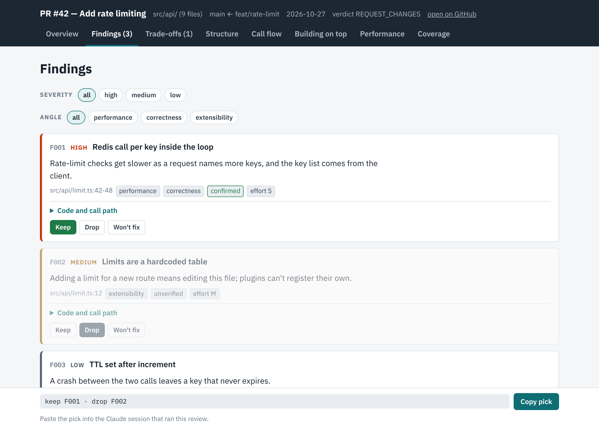
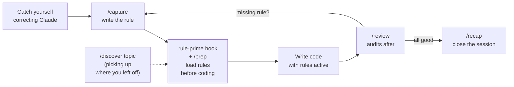
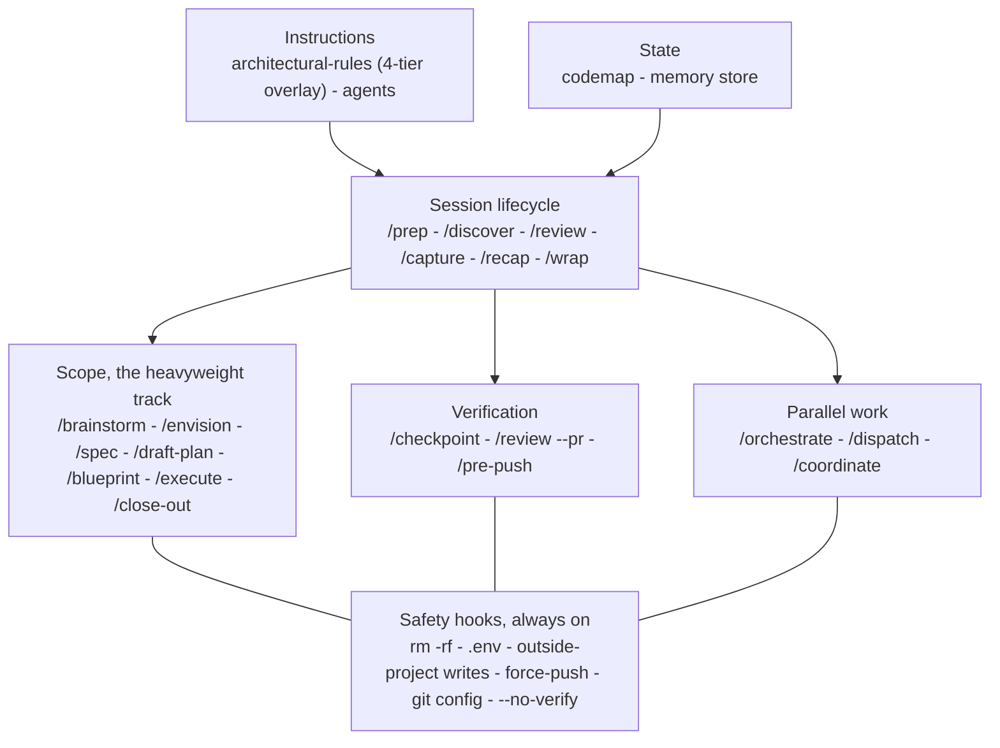
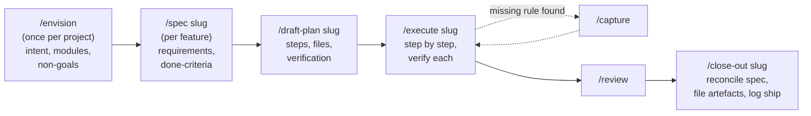

# contexture

[](https://github.com/AcKeskin/contexture/releases) [](LICENSE)

The setup I use to work with AI. A rule corpus that loads itself before I write code, a review pass that checks against it after, safety hooks, and a memory store.

I built it to get better at my own work, after catching myself correcting Claude on the same thing twice. It's built around Claude Code because that's what I use, though the instruction layer ports to other agents. The defaults are how I work, not how you have to: the rule overlay and per-machine config are there to bend them. Sharing it in case it's useful to someone working a similar way. [MIT](LICENSE).



## Quick start

Two ways in. Pick one, not both, or every hook runs twice.

**As a plugin.** Skills come in as `/contexture:<name>`, e.g. `/contexture:review`.

```
/plugin marketplace add AcKeskin/contexture
/plugin install contexture@contexture
```

Each hook bundle is an on/off option in `/plugin configure contexture@contexture`. The plugin brings the project-memory MCP prebuilt. It can't set a status line; use bootstrap for that.

For a small-context or local model, install `contexture-lite@contexture` instead. It keeps seven skills (prep, discover, deliver, review, capture, recap, systematic-debugging) and costs about 2.5K always-on tokens, against 7.4K for the full plugin. Install one of the two, not both.

**With bootstrap.** Clone, bootstrap, restart. Skills keep their bare names (`/review`).

```sh
cd <your-projects-dir>
git clone https://github.com/AcKeskin/contexture.git contexture
cd contexture
node bootstrap/bootstrap.js
```

Bootstrap is idempotent. It links `claude-md`, `architectural-rules`, `skills`, `commands`, `agents` and `hooks` into `~/.claude/`, and merges settings into `~/.claude/settings.json`. Restart Claude Code and it's live. Nothing to add to your CLAUDE.md.

```sh
node bootstrap/bootstrap.js --dry-run                 # preview
node bootstrap/bootstrap.js --exclude=hooks,agents   # skip subtrees
node bootstrap/bootstrap.js --verify                  # audit current state
```

**You need** Node 18+, git, and Claude Code. Optional: `gh` for `/review --pr`, and the .NET SDK plus Godot/Unity only if you build those MCP servers.

**Claude Code version.** Last tested with 2.1.316. Older versions are untested, and some hook events it uses (such as `SubagentStart`) are recent.

This README writes skills by their bare names (`/review`). With the plugin, type `/contexture:review`.

**Platform caveat.** I develop and use this on Windows (PowerShell and Git Bash). The bootstrap, hooks and codemap scripts are plain Node, so macOS and Linux should work, but I haven't run it there. Expect rough edges.

## Start here

Five skills cover most days. The rest are under [What's in it](#whats-in-it).

| Skill | When |
| --- | --- |
| `/prep` | Before coding: load the rules for this task. |
| `/review` | After coding, or on a PR: check against those rules. |
| `/capture` | When you correct Claude: save the rule so it loads next time. |
| `/spec` | Before a feature that spans files: write down what it must do. |
| `/systematic-debugging` | When something's broken: root cause before any fix. |

## What install changes

**Hooks on by default.** Safety (blocks `rm -rf` on top-level paths, `.env` writes, writes outside the project), git (blocks force-push to main, global git-config edits, hook-skip flags), rule priming, the change-discipline rule for subagents, file-history warnings, a snapshot around compaction, subagent output checks, a `/recap` nudge after `/clear`, and codemap nudges. **Off by default:** edit checks (they run project commands) and the `/wrap` and coordinate nudges. Turn any of them off in `/plugin configure contexture@contexture`, or under `enabled.hookBundles` in `~/.claude/hook-config.json` with bootstrap.

**Files it writes.** Hooks write `~/.claude/hook-state/` (per-session scratch, removed after 7 days), `~/.claude/session-state.json`, `~/.claude/edit-checks-trusted.json` once you trust a project's checks, and a codemap marker in projects that opt in. Skills write specs, plans, reviews and the codemap under the project's `.claude/`, after you confirm.

**Network.** Hooks make no network calls. `/review --pr` uses `gh`; `/cycle` searches the web for prior art.

**Bootstrap and `settings.json`.** Bootstrap owns the `hooks`, `statusLine` and `permissions` keys in `~/.claude/settings.json` and rewrites them on each run; other keys are kept. Put your own hooks and permissions in `settings/settings.local.json` so they survive.

## Uninstall

Plugin:

```
/plugin uninstall contexture@contexture
/plugin marketplace remove contexture
```

Bootstrap: delete the links it made in `~/.claude/` (`claude-md`, `architectural-rules`, `skills`, `commands`, `agents`, `hooks`), remove the `hooks`, `statusLine` and `permissions` keys from `~/.claude/settings.json`, and run `claude mcp remove project-memory -s user`. Your `~/.claude/architectural-rules-local/` and memory are left alone; delete them too if you want them gone.

## Troubleshooting

- **Every hook runs twice.** Both the plugin and bootstrap are installed. Keep one.
- **A hook blocked something you meant to do.** The message names the hook. Run the command yourself, or turn that bundle off. For a one-off `--no-verify`, `/allow-skip-hooks` permits the next command.
- **Rules don't seem to load.** Check `rule_prime` is on (plugin), or run `node bootstrap/bootstrap.js --verify`. The always-on tier is capped at about 1K tokens; past that, an advisory names the rule it dropped.
- **No status line.** A plugin can't set one. Use bootstrap.
- **project-memory MCP missing after bootstrap.** Run Claude Code once so `~/.claude.json` exists, then run bootstrap again.

## The loop

The whole idea in one line: write a rule down once, and the system loads it next time it's relevant, then checks against it after.



1. **A rule gets written.** Deliberately with `/capture`, or by correcting Claude mid-session and saying "remember that". Rules are markdown with a bit of frontmatter (scope, when it applies), in `architectural-rules/` or per-project memory.
2. **Rules load before coding, mechanically.** A `rule-prime` hook puts the always and project tiers in context at session start, plus the language tier in a single-language repo, and pulls incremental tiers per prompt by deterministic match. Nothing depends on the agent remembering. `/prep` runs a deeper pass on top when you want it.
3. **Drift gets surfaced.** Moving from auth code to billing mid-task, it says so instead of quietly applying the wrong rules.
4. **`/review` audits after.** Dead code, monolithic files, separation-of-concerns violations, missing patterns, principle violations, comment drift, and naming quality (machine-flavoured names, comments that restate instead of explain).
5. **Misses feed back.** Say review missed something and `/capture` routes it: sharpen a rule, add one, retag, adjust a threshold.
6. **`/recap` closes the session.** What happened, what was learned, what's next. Learned items can graduate into rules.

**Everything is proposed, never applied silently.** Memory writes, fixes, captures: all of them stop and ask. The agent suggests, you decide.

### What a run looks like

```
$ /review --pr 42

Review of: PR #42: Add rate limiting, base main <- feat/rate-limit, +412/-88
Rules loaded: 5                                Run mode: fresh
Angles: correctness · design · hygiene · security · performance · extensibility
Metrics: change +412/-88 in 3 modules · blast radius 23 files · public surface +3/~1/-0 · tests 2 of 5

Needs your call
  F001 · high · Redis call per key inside the loop; the key list comes from the client
  T1   · trade-off: performance vs readability at src/api/limit.ts:40-72

Pick: keep 1,3 · drop 2 · wontfix 4 "<reason>" · tension T1 a|b|skip · all · none · show <id> · walk · page
>
```

Pick in one line, `walk` the findings one at a time, or `page` for the view at the top. On local code, review then asks whether it caught what you wanted. Saying no routes the gap into `/capture`.

## What's in it

Six subsystems, plus safety hooks underneath everything.



| Capability | What it is |
| --- | --- |
| **The loop** | Rules primed before, `/review` after, `/capture` to grow the corpus. What this repo is really about. |
| **Mechanical priming** | The `rule-prime` hook puts relevant rules in context at session start and per prompt. Budget-guarded, deterministic, never blocks a turn. |
| **Rule overlay** | Four tiers that compose update-safely: shipped, company, user, project. `/rules` to override a whole file, patch a field, or disable. Your edits survive `git pull`. |
| **Observe and record** | Three organs that read a codebase and write down what's tacit: `/update-codemap` (structure), `/extract-conventions` (house style, as a project-tier rule), `/glossary` (domain vocabulary, cited by review). `/visualise-codemap` draws the codemap as diagrams. `/write-tests` authors a suite for existing code. |
| **Stored context** | A codemap and a memory store of rules, decisions and lessons, retrieved on demand by `/discover`. `/memory-audit` finds orphans, duplicates and stale entries. Handoffs in the project-memory MCP let one tool leave a note (next steps, what failed) that the next tool claims once. |
| **Context hooks** | Before the first edit of a file, show warnings and lessons that name it. Save the last request, todos, edited files and errors before compaction and restore them after. Point the first search at the codemap, say when it is out of date, and refresh it in the background where a project opts in. Give each subagent the change-discipline rule, which session-start context never reaches. Opt-in: run your own checks after each edit and report only new problems. |
| **Safety hooks** | Default-on. Block `rm -rf` on top-level paths, writes to `.env`, writes outside the project, force-push to main, global git-config edits, and `--no-verify` bypass. |
| **Spec to ship** | The heavyweight track: interview-driven spec (open questions say who answers and what they block; a plan-blocking one stops `/draft-plan`, and `--questionnaire` writes them out for someone else), versioned plan (each step names what it builds on, with any smaller option listed at the review gate), step-by-step execute with per-step verification, `/close-out` to reconcile the spec to what shipped. `/brainstorm` shapes an idea before `/envision`, `/blueprint` shows the concrete shape before coding, and `/human-view` turns a plan or spec into plain prose to approve. `/work-state <slug>` says where a feature sits, and flags a plan pinned to a stale spec. |
| **Parallel work** | `/orchestrate` splits one goal into units, places each (shared tree, worktree, or serialized), fans them out, then verifies and converges. `/coordinate` keeps several live sessions aligned through a shared board so two of them don't edit the same files. `dispatch` fans out independent tasks; `using-git-worktrees` isolates a branch. |
| **Autonomy contract** | `/autonomize` sets one contract for how hard to push, when to stop, when to ask. `/execute`, `/checkpoint` and `/orchestrate` read it at their decision points. Defaults to current behaviour, so it costs nothing until you tune it. |
| **Multi-angle review** | `/review` covers local code and PRs (`--pr`, alias `/pr-review`) and takes `--angles`: one reviewer per angle (correctness, design, performance, readability, extensibility, security, tests, or your team's own), merged and ranked, with conflicts shown as trade-offs. You see metrics and the big picture first, the model does the call tracing, and you pick what to keep in one go or walk through findings one by one. `--pack` adds a plain-language pack on structure, call flow and how to build on the code; `--artifact` opens it all as a page. |
| **Debugging** | `/systematic-debugging` front-doors a bug: reproduce, instrument, find the root cause, before any fix. `test-driven-development` writes the failing test first on non-trivial changes. |
| **Git and PRs** | `/pre-push` checks commits before a push (branch name, AI attribution, leftovers, secrets). `/pr-author` drafts the PR body; `/pr-triage` walks open review comments with you. `/update-changelog` adds one line per shipped unit. |
| **Authoring** | `/new-hook`, `/new-agent`, `/new-mcp` scaffold extensions by interview. `/new-agents-md` writes an `AGENTS.md` for other agents. `/improve-prompt` rewrites a prompt for any model. |
| **Unattended loop** | `/cycle` runs audit, plan, implement, review and a draft PR on its own, one headless session per stage, within limits on cost, hours and plan usage. A status page shows each run. Each run logs its decisions with evidence pointers, audits the log before the PR, and puts a cold reader's flags under `## Attention` in the PR body. `/visual` adds a design contract and screenshot checks for UI projects. |
| **Shortcuts** | Deliberate cut corners get a `shortcut:` comment; `/shortcuts` lists them. |
| **Prose** | `/humanize` flags and rewrites AI texture in user-facing writing. Advisory density, never a binary verdict. |
| **Design pages** | `design-proposal` builds a page a team discusses together: the plan, the other options and their limits. |

Every hook, skill, agent and MCP tool is listed in [docs/reference.md](docs/reference.md).

## How I use it

Two loops at different speeds, and a separate mode for when something's already broken.

**Per session.** The loop above. `/prep` primes, I write code, `/review` audits, `/capture` grows the corpus, `/wrap` closes it out (recap, then close-out if something shipped, then changelog and backlog sweep) so I don't run each by hand. For a one-line fix I skip all of it and just talk to Claude.

**Per feature.** The heavyweight track, for anything bigger than a one-sentence diff. Each phase writes a versioned markdown file the next phase reads.



Specs evolve v1 to v2, plans rebuild against them, nothing is destroyed. `/close-out` ends the chain: it reconciles the spec to what actually shipped and files the spent plan away.

**When something's broken.** Not a loop. You turn up with a symptom and `/systematic-debugging` takes it: reproduce, instrument, root cause first, before any fix is proposed. Different posture, different tools (a debugger, logs, `git bisect`, the codemap to orient). A structural cause can graduate into the feature track; a one-liner you just fix.

| Situation | What I run |
| --- | --- |
| One-line fix, obvious diff | Nothing. Plain Claude. |
| Normal edits in a module I know | `/prep`, code, `/review` |
| A feature spanning files and decisions | `/spec`, `/draft-plan`, `/execute`, `/close-out` |
| Greenfield with no shape yet | Same, with `/envision` first |
| Something's broken | `/systematic-debugging` |
| Several independent tasks at once | `/orchestrate` |
| Letting it work while I'm away | `/cycle` |
| Picking up after a break | `/discover <topic>`, or `/work-state <slug>` |
| End of a session that produced something | `/wrap` |

## Other agents and cloud

Claude Code is the full experience. Copilot CLI, Codex CLI, Gemini CLI, Cursor and OpenCode get the skills and rules, and most get the hooks and the project-memory MCP. Local models run through Claude Code on Ollama, Codex `--oss`, or OpenCode. Install steps and what each tool gets: [docs/other-agents.md](docs/other-agents.md).

For Claude Projects and cloud agents (Copilot, Cursor, Codex cloud, Jules), add this to the environment's setup script. Details in [docs/claude-projects.md](docs/claude-projects.md).

```sh
curl -fsSL https://raw.githubusercontent.com/AcKeskin/contexture/main/cloud/setup.sh | bash
```

## Making it yours

The shipped corpus is one developer's standards. To diverge:

1. **Use `/rules`.** The overlay is the intended way. Override a whole file, patch a single field, or disable a rule, at project, user or company tier. Higher tiers win and your edits survive `git pull`. You don't fork the shipped rules, you layer over them.
2. **Edit `architectural-rules/<scope>/`** to add a language or domain, or drop scopes you don't work in.
3. **Edit `claude-md/`**, the fragments imported into your `~/.claude/CLAUDE.md`.
4. **Add agents and hooks** with `/new-agent` and `/new-hook`, then re-run bootstrap.

## MCP servers

**project-memory** is part of the harness. It backs `/discover`; bootstrap registers it and the plugin ships it. `/discover` degrades gracefully if it isn't there. Plugins run the prebuilt `mcps/project-memory/dist/project-memory.cjs`; after changing its `src/`, rebuild with `npm ci && npm run bundle` in that folder.

The repo also carries two game-engine editor bridges under [`mcps/`](mcps/). They're a separate concern, standalone and opt-in, skippable with `bootstrap --exclude=mcps`. They live here because I built them alongside everything else, not because anything depends on them.

- **unity**, a Unity Editor automation server (TypeScript server plus a C# Editor extension).
- **godot**, a Godot 4.x editor bridge (TypeScript server plus a GDScript plugin).

## Notes

**On Obsidian.** Codemap diagrams, PR review notes and vault exports write to an Obsidian vault, because that's where I keep notes and I wanted the graph view and backlinks in one place. It's a personal choice, pointed at by a `vaultRoot` config value. Without it those features are inert and nothing else cares.

**What I was aiming for.**

- An amplifier for someone who can already do the work, not scaffolding and not a replacement. Every organ earns its place by leverage over ceremony.
- A collaborator, not an auto-learner. Every write is proposed and confirmed.
- Honest. It weighs trade-offs and surfaces weak reasoning even when I didn't ask, instead of agreeing with me.
- Markdown first, so every artefact is reviewable as prose before it becomes behaviour.
- Proposals before code, so mistakes cost paragraphs instead of refactors.
- You own the sync boundary. The repo ships defaults and you decide what travels.

**Where it came from.** A personal research project: trying out agent plugins, conventions and ways of working, and keeping whatever held up. The parts that proved themselves ended up here. The messy history and the dead ends stay private.

## Releases, issues, security

What changed in each version: [Releases](https://github.com/AcKeskin/contexture/releases). Issues are welcome and forks are the intended path: [CONTRIBUTING.md](CONTRIBUTING.md). Report a vulnerability privately: [SECURITY.md](SECURITY.md).

---

Full folder-by-folder reference: **[docs/reference.md](docs/reference.md)**.
