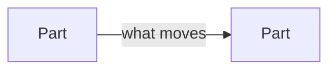

# blueprint: sketch mode

Read when `/blueprint` runs with `--sketch`.

Sketch mode is for designing a feature together, early and in small steps, next to `/spec`. The user and Claude build the shape one view at a time: states, flows, order, classes, interfaces. The result is one markdown file of Mermaid diagrams and signatures that Obsidian and GitHub render as they are.

It differs from Modes 1 and 2:

| | Modes 1 and 2 | Sketch |
| --- | --- | --- |
| When | after `/draft-plan` or from code | any time, usually with or before `/spec` |
| Needs a spec | Mode 1 yes | no |
| Output | versioned `v<N>.md`, one review gate | one living `sketch.md`, changed every turn |
| Pace | whole blueprint at once | one view per turn |

## 1. Open the sketch

- **Slug.** Resolve like the other modes. With no spec and no slug, ask for one; never invent it.
- **File.** `.claude/docs/<slug>/sketch.md`. Create it from the skeleton below if missing. It is a working draft: no version number, no INDEX row, no supersede chain. Git keeps its history.
- **Vault copy.** When `vaultRoot` is set, the mirror is `<Vault>/Projects/<ProjectFolder>/Docs/<slug>-sketch.md`. The helper script (§2) keeps the two in sync; never read or write the mirror yourself.
- **Context.** Read the active spec's frontmatter and its Problem and Goals once, at the start. Not the full spec, not every turn. Use them for names and limits.
- **First view.** Ask which view to start with, or propose one from the ask: a lifecycle starts with States, a protocol with Sequence, a module with Classes.

## 2. One view per turn

Keep each turn small: the user reads the diagram in Obsidian or the editor, not in chat.

1. Run `node <skill dir>/sketch-check.mjs .claude/docs/<slug>/sketch.md [--mirror <vault copy>]` (`<skill dir>` absolute, forward slashes). It copies over whichever copy the user edited last, prints each view's line range (`views: States 18-29 | …`) and runs the name check (§3).
2. Read only the line range of the view you change. Read the whole file only on the first turn.
3. Change that one view with Edit. Never rewrite the file or other views. A new view is one Edit that inserts its heading and block.
4. Run the script again. It pushes the change to the vault and prints the name check.
5. Reply in one or two lines: what changed, and any name-check line. Do not paste the diagram into chat unless the user asks or has no viewer. Do not fix mismatches unasked.
6. Add any open question the change raises to `## Open questions` (same Edit when it fits).

Mermaid templates are in [mermaid-templates.md](mermaid-templates.md). Open it only for a diagram type you have not used in this sketch yet. Keep the fan-out caps from SKILL.md §4.5.

The user can edit the Mermaid directly in Obsidian or the editor, or just say what to change ("add a timeout state", "split Dispatcher", "rename Waiting to Retrying").

### Views

All optional. Add only the ones the feature needs.

| View | Mermaid | Shows |
| --- | --- | --- |
| Overview | `flowchart LR` | parts and what moves between them |
| States | `stateDiagram-v2` | the life of one stateful thing |
| Sequence | `sequenceDiagram` | one interaction that matters, in order |
| Classes | `classDiagram` | types, interfaces, fields, relations |
| Hierarchy | `mindmap` | where parts live: packages, modules, folders |
| Build order | `flowchart TD` | what gets built first; one row can be built in parallel |
| Interfaces | code blocks in the project's language | signatures only, no bodies beyond one-line examples |

## 3. Name check

`sketch-check.mjs` runs it, so you never re-read every view to compare names. It reports, never fixes:

- a sequence participant with no class and not marked external;
- states that differ from the matching enum's members in Interfaces;
- a class with no step in Build order;
- a class with no signature in Interfaces;
- the same thing under two names (`Outbox` vs `OutboxRepo`), as a hint on the first item.

Mark an outside party as external with `actor X` in the sequence, or a `%% external: X, Y` line. Tests: `node --test sketch-check.test.mjs`.

## 4. Close

When the user says the sketch is done, or moves on:

- Move answered questions to `## Decisions` as one line each: the choice, and the reason when it is not obvious.
- Offer the next step once: `/spec <slug>` (it reads the sketch), or `/blueprint <slug>` after `/draft-plan` (it starts from the sketch).
- Stop. Sketch mode never writes the spec, the plan or a blueprint version.

## Skeleton

````markdown
---
slug: <slug>
kind: sketch
updated: YYYY-MM-DD
spec: ../../specs/<slug>/v<M>.md   # omit when there is no spec yet
---

# Sketch: <feature name>

<one line: what the feature does>

## Overview



## Interfaces

```<language>
<signatures>
```

## Open questions

- (<view>) <question>

## Decisions

- (<view>) <choice>, because <reason>
````

Leave out any view heading the sketch does not use.
